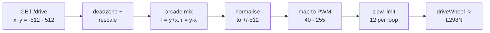

# Wheel Control

The `wheel-control` sketch drives the mascot robot's two wheels from an
**on-screen joystick served by the Arduino UNO R4 WiFi itself**. The board brings up its own
Wi-Fi access point, serves a single page, and that page posts stick positions
back to it about 20 times a second. One L298N dual H-bridge drives both
wheels; the sketch mixes the two axes into a left and a right wheel speed and
writes those speeds out as a direction and a PWM per wheel.

It also knows a handful of **named moves** — `forward`, `spin_right`,
`slight_left` and so on — that one `GET /move` request starts and the board
times by itself, so a tablet app (or a `curl`) can ask for a motion without
streaming stick positions. See section 4. Over the USB cable it also takes
plain-text serial commands — a few short **routines** (`spin`, `dance`,
`surprised`), `stop`, and the tablet's `face:<expr>` changes; see *Serial
commands and routines* in section 4.

The sketch is split across thirteen files, one per concern; section 5 says what
lives where.

There is no physical joystick any more. The L298N's `ENA` / `ENB` are on the
board's PWM pins (jumpers off), so each wheel can be gated in hardware from the page — **both
wheels come up disarmed** and stay that way until you turn them on.

Two things stop the robot: the per-wheel enable, and a **link failsafe** that
cuts the drive if no command arrives for 500 ms. See section 9.

## Flashing it

**`wheel-control.ino` is the file you open and upload.** An Arduino sketch's
entry point is the `.ino` named after its folder — there is no `main` or
`index` — and opening it in the Arduino IDE brings the other twelve files along
as tabs. *Upload* compiles all of them together.

1. Install the board package once: *Tools → Board → Boards Manager* →
   **Arduino UNO R4 Boards** (`arduino:renesas_uno`). Then install the **Servo**
   library: *Tools → Manage Libraries* → **Servo**. The Wi-Fi library
   (`WiFiS3`) ships with the board package.
2. *File → Open* → `wheel-control/wheel-control.ino`.
3. *Tools → Board* → **Arduino UNO R4 WiFi**; *Tools → Port* → the board.
4. Put the chassis on blocks or leave the motor supply off, then *Upload*.

From a terminal instead, with [`arduino-cli`](https://arduino.github.io/arduino-cli/):

```sh
arduino-cli core install arduino:renesas_uno
arduino-cli lib install Servo
arduino-cli compile --fqbn arduino:renesas_uno:unor4wifi wheel-control
arduino-cli upload  --fqbn arduino:renesas_uno:unor4wifi -p /dev/cu.usbmodemXXXX wheel-control
```

---

## 1. The general idea

The page reports two numbers, each -512 → +512, and sends them to
`GET /drive?x=&y=`. Turning those two numbers into two motor speeds happens in
five steps, in this order:



1. **Deadzone.** Anything within ±60 of centre is forced to 0, and what is left
   is stretched back out over the full range.
2. **Arcade mix.** Y is throttle, X is steering: `left = y + x`,
   `right = y - x`.
3. **Normalise.** The mix can exceed the input range on diagonals, so both
   values are scaled down together rather than clipped.
4. **Map to PWM.** Knob travel becomes a signed PWM value, skipping the low
   band where the motors only buzz.
5. **Slew.** The PWM applied to the wheels moves toward the target by at most
   12 counts per 20 ms loop, so nothing gets a step input.

Sign carries direction all the way through. A positive speed spins a wheel one
way, negative the other, and `driveWheel()` splits the sign off into a direction
just before the hardware write.

The centring and calibration step the old analog stick needed is gone: the
browser sends values that are already centred on 0.

A named move (section 4) is nothing more than a stick position the board writes
for itself and holds for a while, so it enters this same pipeline at the top
and every step applies to it unchanged.

---

## 2. The math

### 2.1 Where x and y come from

The knob is clamped to the circle it sits in. For a base of radius `R` and a
pointer `dx`, `dy` from its centre:

```
d = hypot(dx, dy)
if (d > R) { dx *= R/d;  dy *= R/d }      // clamp to the rim, keep the angle

x =  round(dx / R * 512)
y = -round(dy / R * 512)                  // screen y grows downward, forward is up
```

Two things follow. The clamp is **circular, not square**, so the corners of a
square touch area cannot ask for more than full deflection, and dragging a
finger far off the base still yields a sensible direction. And because the rim
is exactly `R`, full deflection is exactly ±512 — which, unlike the old ADC
path, makes PWM 255 exactly reachable.

The board clamps both values to ±512 again on arrival. A missing argument reads
as 0, never as the previous value.

### 2.2 Deadzone with rescaling

A touch knob snaps back to exactly centre, so unlike the old potentiometer there
is no drift to reject. The deadzone now does one job: it gives a patch around
centre where small, unintended movements do nothing.

The naive version — "zero it if `|v| <= 60`" — makes speed jump: the moment you
cross 60 the output snaps from 0 to whatever 60 maps to. `applyDeadzone()`
avoids that by remapping the surviving range back onto the full range:

```
|v| <= 60          ->  0
|v| in [60, 512]   ->  sign(v) * (|v| - 60) * 512 / 452
```

So 60 maps to 0, 512 maps to 512, and everything in between is linear. Speed
rises from zero as you leave the deadzone instead of stepping.

The deadzone is 60/512 ≈ 12% of knob travel in each direction. With no analog
drift left to reject you can safely take `DEADZONE` down toward 0 for finer
control near centre.

### 2.3 Arcade mixing

One stick, two wheels. Y is the common-mode term (both wheels the same way) and
X is the differential term (wheels opposed):

```
l = y + x
r = y - x
```

| knob | y | x | l | r | result |
|---|---|---|---|---|---|
| forward | +512 | 0 | +512 | +512 | both wheels forward |
| back | -512 | 0 | -512 | -512 | both wheels back |
| right | 0 | +512 | +512 | -512 | spin in place |
| left | 0 | -512 | -512 | +512 | spin the other way |
| forward-right | +512 | +512 | +1024 | 0 | arc: outside wheel drives, inside stops |

Note the last row. Because both axes reach ±512 independently, the sum can
reach ±1024 — twice what the PWM stage accepts.

(The circular clamp in 2.1 means a real knob cannot reach `x = y = 512` at
once; the true corner is about 362/362. The normalise step below handles both
cases identically.)

### 2.4 Normalising instead of clipping

```
biggest = max(|l|, |r|)
if (biggest > 512) { l = l * 512 / biggest;  r = r * 512 / biggest }
```

Clipping `l` and `r` to ±512 separately would destroy the ratio between them:
`(1024, 512)` would clip to `(512, 512)` and the robot would drive straight
when you asked for a curve. Scaling both by the same factor keeps `l : r`
intact and only reduces overall speed, so the *shape* of the turn survives and
the edges of the knob's travel stay usable.

### 2.5 Knob travel to PWM

A motor under load does nothing below some minimum duty — it just whines. So
`toPwm()` maps magnitude onto `[MIN_PWM, MAX_PWM]` rather than `[0, MAX_PWM]`,
with an explicit zero:

```
v == 0             ->  0
|v| in [1, 512]    ->  sign(v) * (40 + (|v| - 1) * 215 / 511)
```

The output is 0, or 40–255. It is never 1–39, which is the band that produces
noise and heat and no rotation.

### 2.6 Slew limiting

```
leftSpeed  += clamp(targetLeft  - leftSpeed,  -12, +12)
rightSpeed += clamp(targetRight - rightSpeed, -12, +12)
```

`leftSpeed` / `rightSpeed` are the values actually on the pins; the targets are
what the knob is asking for. Moving 12 counts per 20 ms loop means a full
0 → 255 swing takes ⌈255/12⌉ = 22 loops ≈ **0.44 s**. This softens current
spikes, stops the robot tipping on hard throttle, and turns a knob slammed from
full forward to full reverse into a ramp rather than a reversal.

It also means releasing the knob coasts to a stop over ~0.44 s instead of
braking instantly. **The failsafe deliberately bypasses this** — see section 9.

One side effect: `toPwm()` never *targets* the sub-`MIN_PWM` band, but the ramp
passes through it. Starting from rest the pins see 12, 24, 36, then 48, so the
motors spend ~3 loops (~60 ms) below 40 at the start of every move and the end
of every stop — that brief buzz is expected. Raising `SLEW` shortens it.

### 2.7 Inversion

`LEFT_INVERT` and `RIGHT_INVERT` are applied last, on the way to the hardware.
Two motors mounted facing opposite directions need one of them flipped —
"forward" for the chassis is clockwise for one motor and counter-clockwise for
the other — unless the motor wiring already swaps it, as it does on this robot,
so all four inversions ship as `1`. `INVERT_X` / `INVERT_Y` flip the incoming web
axes, applied first — the quickest fix if steering or throttle comes out
backwards and you would rather not edit the page.

### 2.8 Worked example

Knob pushed forward-right, browser sending `x = +300`, `y = +400`. All
arithmetic on the board is integer, truncating. All four inversions are the
shipped `1`; flipping any of them flips the matching sign below.

| step | left | right |
|---|---|---|
| received | x = +300 | y = +400 |
| deadzone rescale | x = (300-60)·512/452 = **271** | y = (400-60)·512/452 = **385** |
| mix | l = 385+271 = **656** | r = 385-271 = **114** |
| normalise (biggest = 656) | l = 656·512/656 = **512** | r = 114·512/656 = **88** |
| toPwm | 40 + 511·215/511 = **255** | 40 + 87·215/511 = **76** |
| invert | ×1 → **+255** | ×1 → **+76** |
| hardware | left `IN3` HIGH, `ENB` = 255 | right `IN1` HIGH, `ENA` = 76 |

The left wheel runs flat out, the right wheel crawls: a tight right-hand turn,
with the ratio between the wheels preserved from the mix. Reaching those values
takes ~22 loops of slew.

---

## 3. Wiring

**Board: Arduino UNO R4 WiFi** (Renesas RA4M1 + on-board ESP32-S3 radio, USB-C).
Standard UNO headers, `Dn` silkscreen. Its logic is **5 V**, which the L298N's
inputs like better than the ESP32's 3.3 V did.

Pin numbers come straight from the constants in `config.h`. Only `D3`, `D5`,
`D6`, `D9`, `D10` and `D11` do PWM (`analogWrite`), so the two EN pins have to
be among those; the four IN pins are plain digital.

### The L298N — both wheels

| Driver pin | Board pin | Wheel |
|---|---|---|
| `ENA` | `D9`~ | right (`OUT1`/`OUT2`) — PWM |
| `IN1` | `D7` | right — direction |
| `IN2` | `D8` | right — direction |
| `IN3` | `D4` | left (`OUT3`/`OUT4`) — direction |
| `IN4` | `D2` | left — direction |
| `ENB` | `D10`~ | left — PWM |

Six signals plus power: the motor supply to `+12V`/`GND`, and a common ground
between the motor supply and the UNO R4's `GND`. The L298N's inputs read the
board's 5 V as HIGH, so the R4 drives them directly.

**Pull the `ENA` and `ENB` jumpers off the board.** With a jumper on, that
enable is tied HIGH and the wheel is live whatever the sketch says — the
arm/disarm buttons, the failsafe and the boot-disarmed state all work by
holding the enable pin at 0, so a jumpered enable defeats every one of them.

**Direction and speed are separate pins.** `IN1`/`IN2` (or `IN3`/`IN4`) pick
which way current flows through the motor; the enable pin carries the PWM that
sets how hard. `rotateWheel()` writes the direction only with the enable at 0,
so a motor never sees a reversal under power.

**The servo** sits on `D11` (`SERVO_CONTROL`): signal to `D11`, ground to `GND`,
and its power to a supply that can take the stall current — a high-torque servo
like the HS-5998MG can pull two to three amps when it strains, far more than the
board's 5V pin will give, so power it from the motor supply (or its own 5–6 V
rail) with a common ground, never from the R4. `servo.ino`
drives it through the Arduino **Servo** library (the R4 has no LEDC peripheral).

**Still free on this board:** the analog pins `A0`–`A5`, `D3`~, `D5`~, `D6`~,
`D12`, and `D0`/`D1` if you do not use `Serial1` for a wired voice module. `D13`
is the on-board LED.

**Before the L298N** each wheel had its own IBT-2 (BTS7960) bridge on twelve
signals, and before this board the whole sketch ran on a 30-pin ESP32 DevKit v1.
Neither build is kept in this folder.

### UNO R4 pin constraints

`analogWrite()` only works on the PWM pins, so the two EN pins are the real
constraint if you move things:

- **PWM (EN pins) must be one of `D3`, `D5`, `D6`, `D9`, `D10`, `D11`.** The
  four IN pins can be any free digital pin.
- **`D0`/`D1` are `Serial1`** (a wired voice module — see `VOICE_LINK` in
  `config.h`), and **`D13` is the on-board LED** — avoid both unless you mean it.
- **The Servo library and `analogWrite()` share the RA4M1's GP timers.** Keep
  the servo pin off the EN pins (it is, on `D11`) so they cannot contend.

---

## 4. Web control

### Connecting

The board runs as an **access point** — it makes its own network rather than
joining yours. Nothing else is needed: no router, no app, no filesystem upload.

1. Power the board.
2. Join the Wi-Fi network **`mascot-robot`**, password **`mascotbot`**.
3. Open **`http://192.168.4.1`**.

The IP is printed to serial at 115200 baud on boot as well. Your phone has no
internet while it is on this network, which is why the page loads no fonts,
frameworks or icons from anywhere — it is one self-contained ~6 KB document
compiled into the sketch as a `PROGMEM` string (`page.h`) and served with
`send_P()`.

**Change the SSID and password** in `config.h`:

```c
const char *AP_SSID = "mascot-robot";
const char *AP_PASS = "mascotbot";
```

WPA2 needs **8 characters or more**. With a shorter one `beginAP()` quietly
brings the network up with no password at all, so anyone in range can drive the
robot. It does not warn you.

### The page

A round base with a draggable knob, built on Pointer Events so one code path
covers finger, stylus and mouse. `setPointerCapture()` keeps the drag alive when
your finger leaves the base, and `touch-action: none` stops the browser from
scrolling or pinch-zooming the page out from under you.

Under the knob, a **servo** slider, 0–180°. Dragging it sends `/servo` with the
latest angle, one request at a time, and the readout beside it follows your
finger at once. When the board's reply carries a different angle — another
phone moved it — the slider follows the board, except while your finger is on
it or an angle of yours is still on its way.

Under the slider, three readouts:

| Readout | Meaning |
|---|---|
| `link` | green `linked` once a request succeeds, red `no link` the moment one fails or exceeds its 250 ms timeout |
| `axes` | what the knob is asking for, -512 → +512 |
| `wheels` | the signed PWM actually on the pins, read back from the board's reply |

Below the readouts, **LEFT** and **RIGHT** arm each wheel independently — green
`ON`, grey `OFF`. They gate that wheel's enable pin, so a disarmed wheel is
dead in hardware, not just commanded to zero. Both start `OFF` after every boot.

Plus a **STOP** button, which centres the knob and calls `/stop`. STOP does not
disarm; it zeroes the axes and leaves the enables as you set them.

### The HTTP API

| Route | Returns | Purpose |
|---|---|---|
| `GET /` | the page, `text/html` | what the browser loads |
| `GET /drive?x=<-512..512>&y=<-512..512>` | status | one control command, and the heartbeat that keeps the failsafe fed. Anything other than `0,0` also cancels a running move. Ignored while a routine runs |
| `GET /enable?l=<0\|1>&r=<0\|1>` | status | arms or disarms either wheel; an omitted argument leaves that wheel alone |
| `GET /stop` | status | zeroes both axes immediately, and cancels a running move or routine |
| `GET /move?name=<move>&ms=<hold>&speed=<0..100>` | status, 400, or 409 while a routine runs | starts a named move on the board's own clock — see *Named moves* below |
| `GET /moves` | the move names, comma-separated | what `/move` accepts, so a client need not hard-code the list |
| `GET /servo?a=<0..180>` | status, or 400 | moves the servo to that angle, clamped. Independent of the wheels: it neither feeds the failsafe nor counts as stick input |
| `GET /face?name=<expr>` | status, or 400 | runs the body-language gesture for an expression (`faces.ino`). A curl/WiFi convenience; the tablet drives faces over USB serial instead (below) |
| anything else | 404 `not found` | |

Every control route answers with the same one-line **status**:

```
<leftSpeed>,<rightSpeed>,<leftEnabled>,<rightEnabled>,<servoDeg>
```

e.g. `255,76,1,1,90`. The board is the authority on all five, so the readouts and
the arm buttons track it no matter which request came back last — which is also
what keeps two phones on the same page consistent, and what restores the buttons
correctly after a reload. `/drive` arguments are clamped server-side.

You can drive the robot from the command line with the same API:

```sh
curl "http://192.168.4.1/enable?l=1&r=1"    # arm both wheels
curl "http://192.168.4.1/drive?x=0&y=400"   # forward
curl "http://192.168.4.1/stop"
curl "http://192.168.4.1/enable?l=0&r=0"    # disarm
```

Remember the failsafe: a single `curl` drives for 500 ms and then cuts out. To
keep moving you have to keep sending — or ask for a named move.

### Faces

The tablet's face app tells the board which expression ACMO is showing, and
the board answers with a little body language — a small nudge and/or a servo
gesture. The app is wired to the board over the **USB cable** and writes one
line per expression change to the board's `Serial`, `face:happy`,
`face:angry` and so on; `readSerial()` (in `serial-link.ino`) reads it and
`runFace()` (in `faces.ino`) runs the gesture. `GET /face?name=<expr>` does the same over
WiFi, kept as a `curl` test path. The gestures: *sad/happy/passionate* nudge
a tiny bit (back, forward, forward); *angry/excited* nudge back and shake the
head (servo 85 → 95 → 90); *annoyed* swings the servo to 120; *idle/surprised*
rest at 90. The nudges go through `startMove()`, so **nothing moves until the
wheels are armed** — until then only the servo gestures show. Tune the sizes
with the `FACE_*` constants in `config.h`.

### Serial commands and routines

The board reads one plain-text command per line from `VOICE_LINK` (`Serial`,
the USB cable, as shipped — or `Serial1` on `D0`/`D1`, see `config.h`):

| command | does |
|---|---|
| `spin` | one full turn on the spot (`SPIN_360_MS`) |
| `dance` | back, forward, back, a small wiggle, then the full turn |
| `surprised` | a fast ~10 cm hop straight back |
| `stop` | cancels whatever is running and centres the stick; never refused |
| `face:<expr>` | the same gesture as `GET /face?name=<expr>` |

Commands are trimmed and lower-cased; newline, carriage return or both end a
line, and a line over 32 characters is dropped whole. **Open the port at
115200.** On the UNO R4 WiFi the USB-C socket is bridged to the RA4M1's UART
by the on-board ESP32-S3, so — unlike a native-USB board — the baud is real
and a mismatch reads as garbage. The board's own log goes out on the same port,
so the sender has to tolerate lines it did not ask for. The Arduino Serial
Monitor at 115200 is a complete test harness.

`spin`, `dance` and `surprised` are **routines**: fixed sequences of named
moves that block until they finish. A routine refuses to start while either
wheel is disarmed or while somebody has driven from the page in the last
`STICK_PRIORITY_MS` (1.5 s); once running, it ignores the knob and `/move`
(409), and only `stop`, the page's STOP button, or disarming a wheel ends it.
`routines.h` is the full reference.

### Named moves

`GET /move?name=<move>` asks the board to hold a stick position on its own
clock, so a client can say *spin right for a second* in one request instead of
streaming `/drive` commands. The names come from the `MOVES[]` table in
`moves.ino`, and `GET /moves` returns them:

| move | x | y | what the robot does |
|---|---|---|---|
| `forward` | 0 | +512 | both wheels forward |
| `backward` | 0 | -512 | both wheels back |
| `spin_left` | -512 | 0 | wheels opposed: turns on the spot |
| `spin_right` | +512 | 0 | turns on the spot the other way |
| `turn_left` | -360 | +512 | tight turn: the inside wheel nearly stops |
| `turn_right` | +360 | +512 | |
| `slight_left` | -150 | +512 | gentle arc: both wheels still driving |
| `slight_right` | +150 | +512 | |
| `stop` | 0 | 0 | centres the stick and holds it there |

`x` and `y` are stick positions in the same frame the page sends, so a move
goes through the whole of section 2 exactly as a knob would — inversion,
deadzone, mix, normalise, PWM, slew — and the per-wheel enables still gate it:
**a disarmed wheel does not move for a move either.**

Two optional arguments:

| argument | default | meaning |
|---|---|---|
| `ms` | `MOVE_DEFAULT_MS` = 500 | how long to hold the stick, in ms. **Capped at `MOVE_MAX_MS` = 3000** whatever you ask for — section 9 says why |
| `speed` | 100 | percent of full deflection. It scales the stick, not the PWM, so anything below about 12 % lands inside the deadzone (section 2.2) and does nothing |

```sh
curl "http://192.168.4.1/enable?l=1&r=1"                # arm both wheels
curl "http://192.168.4.1/move?name=spin_right&ms=1000"  # one second on the spot
curl "http://192.168.4.1/move?name=forward&speed=50"    # 500 ms at half deflection
curl "http://192.168.4.1/moves"                         # forward,backward,spin_left,...
curl "http://192.168.4.1/move?name=sideways"            # 400: unknown move "sideways", try one of: ...
```

When the hold ends the stick is centred and the wheels ramp down through slew,
exactly like a released knob. Until then:

- a new `/move` replaces the running one;
- `/stop` cancels it;
- a **deflected** knob cancels it — any `/drive` other than `0,0` — because
  whoever is holding the phone should always win. A `/drive` of `0,0` does
  *not*: that is the page's idle heartbeat, sent at 5 Hz whenever the page is
  open, and it would otherwise kill every move within 200 ms of a phone being
  connected;
- disarming a wheel stops that wheel, as always.

(Inside a routine the knob and `/move` are turned away instead — see *Serial
commands and routines* above.)

Add a move by adding a row to `MOVES[]` in `moves.ino`. Nothing else needs to
change — `/moves` and the 400 message read the table.

### Timing

| | rate | set by |
|---|---|---|
| knob held | one request per 50 ms tick (20 Hz) | `TICK_MS` |
| knob idle | one heartbeat per 200 ms (5 Hz) | `IDLE_TICKS` × `TICK_MS` |
| after release | 3 zero commands, then back to idle | `burst` |
| per-request timeout | 250 ms, via `AbortController` | inline |

`TICK_MS` and `IDLE_TICKS` are the first two lines of the page's script.

Exactly **one request is in flight at a time**. Pointer events fire at 60–120 Hz;
a fixed 50 ms tick reads the latest knob position rather than sending on every
move, and the in-flight guard means a slow reply delays the next command instead
of queueing a backlog of stale ones behind it.

The release burst matters: the failsafe is the backstop for a *dropped* link,
but letting go of the knob should stop the robot immediately, so the zero is
sent three times rather than trusting one packet. It counts **sends, not ticks**
— a tick that is skipped because the previous request has not come back yet does
not consume one of the three.

### Why polling and not WebSockets

The UNO R4's Wi-Fi library (`WiFiS3`) has no WebServer and no WebSocket server,
so the sketch hand-rolls a tiny HTTP server, `MiniServer` in `mini-server.h`,
over `WiFiServer`/`WiFiClient`. Plain-HTTP polling keeps that server small: it
parses one GET at a time and needs no framing or persistent-connection logic.

`MiniServer` handles **one connection at a time** and closes each after replying
(`Connection: close`), so every request is its own short TCP connection — at
20 Hz, 20 a second. It drives fine; it is simply not free. Its request read is
**time-bounded** (150 ms): a client that opens a connection and then sends
nothing — browsers do this speculatively — is dropped rather than allowed to
stall the control loop, so a half-open connection cannot freeze steering. The
failsafe remains the backstop for a genuinely dropped link.

If throughput ever bites, raise `TICK_MS` in the page to 100 — 10 Hz is still
perfectly drivable.

---

## 5. Program structure

### The files

The sketch is one folder, and the Arduino IDE shows each file in it as a tab:

| File | Holds |
|---|---|
| `wheel-control.ino` | The globals every tab shares, `setup()`, `bootDance()`, `loop()`, `failsafe()`, `report()` |
| `config.h` | Pins, tuning constants, Wi-Fi credentials, safety limits — **the only file you should need to edit** |
| `mini-server.h` | `MiniServer`, the tiny WebServer stand-in over `WiFiS3` (the UNO R4 has no WebServer class) |
| `mixing.ino` | The math of section 2: `applyDeadzone()`, `arcadeMix()`, `toPwm()`, `slew()`. Pure functions |
| `moves.ino` | The `MOVES[]` table and the functions that start, time and cancel a move |
| `faces.ino` | A gesture per app expression (`faceHappy()`, `faceAngry()`, …) and the `/face` route; `runFace()` dispatches by name |
| `routines.ino` | `spin()`, `dance()`, `surprised()`, the emotion placeholders, and the routine guards |
| `routines.h` | The contract for a routine and the serial link: what it is, what blocks, what stops it, who gets the wheels. Included by `routines.ino` and `serial-link.ino` |
| `serial-link.ino` | `readSerial()` and `runCommand()`: reads commands off `VOICE_LINK` and calls the routines |
| `web.ino` | `startAccessPoint()`, `startServer()`, every route handler, `statusBody()` |
| `page.h` | `INDEX_HTML`, the control page. Included only by `web.ino` |
| `servo.ino` | The servo on `SERVO_CONTROL`: `setupServo()`, `setServo()` |
| `wheels.ino` | Everything that touches a wheel pin, for the L298N: `setup*Wheel()`, `enableWheel()`, `driveWheel()`, `rotateWheel()`, `stopWheels()` |

There is no build system and nothing to configure: every `.ino` in the folder
is compiled **as one file** — the one named after the folder first, the rest
in alphabetical order — with a prototype for every function inserted near the
top of the main file, which is what lets the tabs call each other in any
order. Two rules follow from that, and both show up as compile errors if
ignored:

1. **A global that more than one tab uses is defined in `wheel-control.ino`.**
   A function cannot use a variable defined further down the combined file,
   and "further down" means a tab that sorts later alphabetically, which has
   nothing to do with what makes sense. A tab may keep state that only its own
   functions touch (`moveUntil` in `moves.ino`), because those functions come
   after it in the same file.
2. **No struct of our own in a function signature.** The generated prototypes
   land above every tab, so a `Move` in a parameter list would be named before
   it is defined. `findMove()` returns an index for that reason.

`.h` files are ordinary C++ headers and follow ordinary rules: `config.h`
*defines* its variables, so it carries `#pragma once` and is included exactly
once, from the main file.

### `setup()`

Runs once, in this order, and the order is deliberate:

1. `Serial.begin(115200)` — the baud the Serial Monitor and the serial link
   both expect. If `VOICE_LINK` is `Serial1`, it is opened at 115200 too.
2. `setupRightWheel()` / `setupLeftWheel()` — direction pins to `OUTPUT` and
   LOW, enable pins to `OUTPUT` with **0 duty**. The motors coast here, before
   anything else can happen.
3. `stopWheels()` — both enables to 0 again and directions cleared, **before
   the radio powers up**, so the Wi-Fi start-up current surge cannot find a
   driver input mid-write.
4. `enableWheel('R', START_ENABLED)` / `enableWheel('L', …)` — the enables are
   already at 0 from step 2; this makes the disarmed state explicit and sets
   the flags the page reads back.
5. `setupServo()` — attach `SERVO_CONTROL` (`D11`) through the Servo library and
   go to `SERVO_START_DEG`. Kept off the wheel EN pins so the shared RA4M1
   timers do not contend.
6. `startAccessPoint()` — `WiFi.config(192.168.4.1)`, then `WiFi.beginAP()`,
   print the IP.
7. `startServer()` — register the routes and `begin()` listening.
8. `bootDance()` *(currently commented out in `setup()`)* — arm both wheels, run `dance()` from `routines.ino`,
   then set both enables back to `START_ENABLED`. This is the first thing the
   robot visibly does after a flash, and after every reset. It comes after the
   server is up because the routine pumps `handleClient()` while it blocks and
   the page STOP button is the only HTTP route that can end it.
9. Ready message.

### `loop()`

No `delay()` anywhere — the loop runs flat out serving HTTP and gates the
control step on `millis()`:

```
server.handleClient()            every pass, as fast as possible
readSerial()                     every pass; a routine command blocks here

if (millis() - lastStep < LOOP_MS) return
lastStep = millis()

serviceMove()                    a running move stamps lastCommand itself,
                                 so this comes before the check -- section 9

if (millis() - lastCommand > COMMAND_TIMEOUT_MS) { failsafe(); return }

applyDeadzone -> x, y
arcadeMix     -> l, r, mixed then normalised so |l|, |r| <= 512
toPwm         -> targetLeft, targetRight   (0 for a disarmed wheel)
slew          -> leftSpeed, rightSpeed
driveWheel    -> hardware, with LEFT_INVERT / RIGHT_INVERT applied
report        -> serial, rate-limited
```

`LOOP_MS` sets the control rate, and `SLEW` is defined per loop, so the two
constants together determine the acceleration ramp. Changing one changes the
ramp.

Every route handler runs from inside `handleClient()`, on the same task as
`loop()` — so `webX`, `webY`, `lastCommand`, `moveUntil` and the enable flags
need no locking and no `volatile`.

---

## 6. Constants

All in `config.h`.

| Name | Value | Meaning |
|---|---|---|
| `AP_SSID` | `"mascot-robot"` | Network the board creates. |
| `AP_PASS` | `"mascotbot"` | **Change it.** 8 characters minimum or the network comes up open. |
| `VOICE_LINK` | `Serial` | Port the serial link reads commands from. `Serial1` for a module wired to `D0`/`D1`. |
| `COMMAND_TIMEOUT_MS` | 500 | Silence after which the drive is cut. Section 9. |
| `START_ENABLED` | `false` | Arm state at boot. `false` means a reset or a fresh upload cannot drive anything until you tap a wheel on. Set `true` for the old always-live behaviour. |
| `MOVE_DEFAULT_MS` | 500 | How long `/move` holds the stick when the request gives no `ms`. |
| `MOVE_MAX_MS` | 3000 | The longest any `/move` can hold, whatever it asks for. The link failsafe is suspended for the length of a move, so this is the bound on unattended driving — section 9. |
| `DEADZONE` | 60 | Counts either side of centre treated as neutral. Safe to lower toward 0 now that the input is digital. |
| `MIN_PWM` | 40 | Lowest PWM that actually turns a loaded motor. Raise if the robot stalls and buzzes at low throttle; lower if it lurches off the deadzone. |
| `MAX_PWM` | 255 | Full duty. Lower it to cap top speed. |
| `SLEW` | 12 | Max PWM change per loop. Lower = gentler and slower to respond; higher = snappier and harder on the battery. |
| `LOOP_MS` | 20 | Control-step period, ~50 Hz. |
| `LEFT_INVERT` | 1 | Flip to -1 if the left wheel runs backwards. |
| `RIGHT_INVERT` | 1 | Flip to -1 if the right wheel runs backwards. |
| `INVERT_X` | 1 | Flip to -1 if steering is reversed. |
| `INVERT_Y` | 1 | Flip to -1 if throttle is reversed. |
| `SERVO_MIN_US` | 500 | Pulse width at 0°. Raise toward 1000 if the servo buzzes or strains at that end. |
| `SERVO_MAX_US` | 2400 | Pulse width at 180°. Lower toward 2000 if it strains at that end. |
| `SERVO_START_DEG` | 90 | Where the servo goes at boot. |
| `FACE_NUDGE_MS` | 300 | Length of a face-triggered nudge — "a tiny bit". |
| `FACE_NUDGE_SPEED` | 35 | Speed of the happy/passionate/angry/excited nudge, % of full. |
| `FACE_SAD_SPEED` | 20 | Sad backs off more gently. |
| `FACE_ANNOYED_SERVO` | 120 | Where *annoyed* swings the servo (from 90). |
| `FACE_SHAKE_LO` / `FACE_SHAKE_HI` | 85 / 95 | The angry/excited head-shake endpoints (85 → 95 → 90). |
| `FACE_SHAKE_MS` | 120 | Dwell at each shake position. |
| `SPIN_360_MS` / `SPIN_SPEED` | 1800 / 70 | One full turn on the spot, for `spin()` and the end of `dance()`. Must stay ≤ `MOVE_MAX_MS`. Calibrate — see `config.h`. |
| `NUDGE_MS` / `NUDGE_SPEED` | 400 / 50 | The ~10 cm back-and-forth steps of `dance()`. |
| `WIGGLE_MS` / `WIGGLE_SPEED` | 250 / 60 | The small turn each way in `dance()`. |
| `SURPRISED_MS` / `SURPRISED_SPEED` | 300 / 100 | The fast hop back of `surprised()`. |
| `STICK_PRIORITY_MS` | 1500 | How long after the knob was last deflected (or STOP pressed) a serial routine is refused. |

## 7. Globals

In `wheel-control.ino` unless the row says otherwise.

| Name | Type | Meaning |
|---|---|---|
| `server` | `MiniServer` | The hand-rolled HTTP server (mini-server.h), on port 80. |
| `INDEX_HTML` | `const char[] PROGMEM` | The whole control page. In `page.h`. |
| `webX`, `webY` | `int` | Last commanded axes, -512 → +512. Written by `handleDrive()`. |
| `lastCommand` | `unsigned long` | `millis()` of the last `/drive`, `/stop` or `/move` — or of the last control step while a move runs. The failsafe measures against this. |
| `lastStickInput` | `unsigned long` | `millis()` of the last deflected `/drive` or `/stop`; 0 until then. Decides whether a routine may start. |
| `lastStep` | `unsigned long` | `millis()` of the last control step, for the `LOOP_MS` gate. |
| `leftSpeed`, `rightSpeed` | `int` | Signed PWM currently applied, -255 → 255. Persist across loops — slew needs the previous value. |
| `leftEnabled`, `rightEnabled` | `bool` | Whether each wheel's enable pin may carry a duty cycle. Written only by `enableWheel()`; read by `rotateWheel()`, which writes 0 to a disarmed wheel whatever it is asked. |
| `servoDeg` | `int` | Where the servo was last told to go, 0–180. Written by `setServo()`, reported in the status line. |
| `lastPrint` | `unsigned long` | `millis()` of the last serial report, for rate limiting. |
| `MOVES`, `MOVE_COUNT` | `const Move[]`, `const int` | The move table — name, x, y — and its length. In `moves.ino`. |
| `moveUntil` | `unsigned long` | `millis()` at which the running move stops holding the stick; 0 when none is running. In `moves.ino`, touched only by its own functions. |
| `inRoutine` | `bool` | Whether a routine is running. In `routines.ino`; read elsewhere through `routineRunning()`. |

## 8. Functions

| Tab | Function | Does |
|---|---|---|
| `main` | `setup()` | Boot sequence, section 5. |
| `main` | `loop()` | HTTP and serial service plus one gated control step, section 5. |
| `main` | `controlStep(unsigned long now)` | One control step — move service, failsafe check, mix, slew, drive, report. Its own function so a routine can run it while it blocks. |
| `main` | `logf(const char *fmt, ...)` | `printf()` to `Serial`; the R4 core's `Serial` has none. |
| `main` | `bootDance()` | Arms both wheels, runs `dance()`, then sets both enables back to `START_ENABLED`. Called last in `setup()`, section 5. |
| `web` | `startAccessPoint()` | `WiFi.config(192.168.4.1)` then `WiFi.beginAP(AP_SSID, AP_PASS)`, prints the IP. Says so on serial and returns if the module is missing or the AP fails to come up. |
| `web` | `startServer()` | Registers `/`, `/drive`, `/enable`, `/stop`, `/move`, `/moves`, `/servo`, `/face` and the 404, then starts listening. |
| `web` | `statusBody()` | Builds the `L,R,leftEnabled,rightEnabled,servoDeg` line every control route replies with. |
| `wheels` | `enableWheel(char wheel, bool on)` | The only function that arms or disarms a wheel. Brings its enable pin to 0 and zeroes its stored speed on both edges, so re-arming cannot resume at whatever it was doing. |
| `web` | `handleRoot()` | `send_P()` streams `INDEX_HTML` to the client in chunks. |
| `web` | `handleDrive()` | Clamps `x` and `y` to ±512 into `webX`/`webY`, stamps `lastCommand`, replies with the status line. A missing argument reads as 0. Anything other than `0,0` cancels a running move; `0,0` — the page's idle heartbeat — leaves it alone and does not touch the stick. |
| `web` | `handleEnable()` | Arms/disarms from `l` and `r` arguments. An absent argument leaves that wheel alone, so one button cannot disarm the other by omission. |
| `web` | `handleStop()` | Cancels any move, zeroes both axes and stamps `lastCommand`. Does not change the enables. |
| `web` | `handleMove()` | Reads `name`, `ms` and `speed`, hands them to `startMove()`, replies with the status line — or 400 and the list of names if the move does not exist. |
| `web` | `handleMoves()` | Replies with `listMoves()`. |
| `web` | `handleServo()` | Hands `a` to `setServo()` and replies with the status line — or 400 if `a` is missing. |
| `faces` | `runFace(name)` | Runs the gesture for an expression name; `false` for an unknown one. Called by both the `/face` route and the serial `face:` command. |
| `faces` | `handleFace()` | The `/face?name=` route: `runFace()` then the status line, or 400. |
| `faces` | `faceHappy()` … | One per app expression: a tiny nudge and/or servo gesture. Movements go through `startMove()`, so they respect the wheel arm gate and are skipped while a move is already running. |
| `servo` | `setupServo()` | Attaches `SERVO_CONTROL` through the Servo library (pulse range `SERVO_MIN_US`–`SERVO_MAX_US`), then `setServo(SERVO_START_DEG)`. Says so on serial if the attach fails. |
| `servo` | `setServo(int deg)` | The only function that writes the servo pin. Clamps to 0–180, stores `servoDeg`, maps the angle to a `SERVO_MIN_US`–`SERVO_MAX_US` pulse and writes it with `writeMicroseconds()`. |
| `web` | `handleNotFound()` | 404. |
| `main` | `failsafe()` | Zeroes the axes **and the applied speeds**, then `stopWheels()` — no slew ramp. Returns early when already stopped, so it neither re-writes the pins nor spams serial. |
| `mixing` | `applyDeadzone(int v)` | Axis value → 0 inside the deadzone, otherwise rescaled to the full ±512 range. Section 2.2. |
| `mixing` | `arcadeMix(int x, int y, long &l, long &r)` | `l = y + x`, `r = y - x`, then both scaled down together if either exceeds 512. Sections 2.3 and 2.4. |
| `mixing` | `toPwm(long v)` | Mixed value (±512) → signed PWM, 0 or ±40…255. Section 2.5. |
| `mixing` | `slew(int current, int target)` | Returns `current` moved toward `target` by at most `SLEW`. Section 2.6. |
| `main` | `report(int x, int y)` | Prints `x`, `y`, `L`, `R` to serial at most every 250 ms. Returns immediately otherwise, so it never stalls the loop. |
| `moves` | `findMove(const String &name)` | Index of a name in `MOVES[]`, or -1. Case-sensitive. |
| `moves` | `startMove(const String &name, long ms, int speed)` | Writes the move's stick position, scaled by `speed`, into `webX`/`webY`; stamps `lastCommand`; sets `moveUntil`. `ms <= 0` means `MOVE_DEFAULT_MS`, and **the hold is capped at `MOVE_MAX_MS` here**, not in the route, so every caller gets the cap. Returns `false` for an unknown name and then changes nothing. |
| `moves` | `serviceMove(unsigned long now)` | One call per control step, before the failsafe check. While the hold lasts, stamps `lastCommand`. When it ends, centres the stick and keeps stamping until both wheels are at rest, so the ramp-down is never mistaken for a lost link. Then clears `moveUntil`. |
| `moves` | `cancelMove()` | Clears `moveUntil`. Does not touch the stick — the caller decides what happens next. |
| `moves` | `moveRunning()` | Whether `moveUntil` is set. |
| `moves` | `listMoves()` | The names in `MOVES[]`, comma-separated. |
| `wheels` | `driveWheel(char wheel, int speed)` | Splits a signed speed into a direction (+1/-1/0) and a magnitude, then calls `rotateWheel()`. |
| `wheels` | `rotateWheel(char wheel, int dir, int speed)` | The only function that writes a wheel pin. Enable to 0, then the two direction pins for `dir`, then the enable back up to `speed` (0–255) — and 0 whatever was asked if the wheel is disarmed. |
| `wheels` | `stopWheels()` | `rotateWheel(..., 0, 0)` on both wheels — both enables to 0, both motors coasting. Does not change the arm flags; that is `enableWheel()`'s job. |
| `wheels` | `setupLeftWheel()`, `setupRightWheel()` | One wheel's pins: direction pins to `OUTPUT` and LOW, enable to `OUTPUT` at 0 duty. |
| `serial-link` | `readSerial()` | Reads `VOICE_LINK` without blocking, assembles a line, and hands each complete one to `runCommand()`. Blocks only for the length of a routine it starts. |
| `serial-link` | `runCommand(const String &cmd)` | `stop`, `spin`, `dance`, `surprised` or `face:<expr>`; logs anything else. |
| `routines` | `spin()`, `dance()`, `surprised()` | The routines. Block until done; `true` if they ran to the end. `routines.h` has the rules. |
| `routines` | `beginRoutine()`, `endRoutine()` | The guard: refuses (and says why) if a routine is running, the joystick has priority, or a wheel is disarmed. |
| `routines` | `runMove(name, ms, speed)` | One step of a routine: `startMove()`, then runs `controlStep()` and both pumps until the move ends. `false` if cancelled. |
| `routines` | `routineRunning()`, `stickActive()` | Whether a routine owns the wheels; whether the knob still has priority. |

### On `rotateWheel()`

An L298N cannot shoot through the way a BTS7960 can — its logic never turns
both sides of a bridge on at once — but a motor reversed under full power is
still a current spike and a jolt. The write order avoids it:

```c
analogWrite(enPin, 0);                        // duty off
digitalWrite(aPin, (dir ==  1) ? HIGH : LOW); // then the direction
digitalWrite(bPin, (dir == -1) ? HIGH : LOW);
analogWrite(enPin, speed);                    // then the duty back
```

`dir == 0` leaves both direction pins LOW, so the motor coasts. And `speed` is
forced to 0 when the wheel is disarmed, whatever the caller asked: on this
driver the enable pin *is* the arm switch, so the check lives where the pin is
written. Keep both if you touch this function.

---

## 9. Safety

Control travels over a radio link, which can simply stop. Three things cover
that now — the per-wheel enable, the link failsafe, and the boot ordering — and
one window is still outside software's reach.

### The link failsafe

Every `/drive`, `/stop` and `/move`, and a serial `stop`, stamps `lastCommand`. If a control step finds more
than `COMMAND_TIMEOUT_MS` (500 ms) of silence, `failsafe()` runs: both axes to
0, both applied speeds to 0, `stopWheels()`, done.

It **bypasses `slew()` on purpose.** Ramping down from full speed takes 22 loops
≈ 0.44 s, which on top of the 500 ms timeout would mean nearly a full second of
a robot driving somewhere you are no longer steering it. Cutting outright costs
a harder stop and buys back that 0.44 s:

| | time from link loss to wheels stopped |
|---|---|
| cut outright (what it does) | ~0.5 s |
| ramped down through `slew()` | ~0.94 s |

Letting go of the knob normally still ramps down — the failsafe path only fires
when the link itself has gone quiet.

It deliberately does **not** disarm. The arm flags stay as you set them, so
the robot neither re-arms itself nor needs re-arming when the link returns. On
the L298N the cut is `EN` at 0 with both `IN` pins LOW, so the motors coast to
a stop rather than braking.

The browser's 5 Hz idle heartbeat is what keeps the failsafe fed while you are
connected but not driving. That means closing the tab, locking the phone or
walking out of range all stop the robot within half a second.

### Moves and the failsafe

A named move is the one case where the board drives with nobody sending
commands. For the length of the hold `serviceMove()` stamps `lastCommand`
itself, every control step — otherwise the failsafe above would cut every move
at 500 ms. That suspends the link failsafe on purpose, and three things bound
what it can do:

- **`MOVE_MAX_MS` caps the hold** at 3 s whatever the request asked for. The
  cap is applied in `startMove()`, not in the route handler, so any future
  caller gets it too. A client that dies mid-move has a robot that stops
  within 3 s plus the slew ramp, and its wheels never re-arm on their own.
- **The enables still gate it.** A move is a stick position and nothing more;
  a disarmed wheel is dead in hardware for a move exactly as for the knob.
- **Whoever is holding the phone wins.** A deflected knob or `/stop` cancels
  the move at once. (A routine is the exception: only `/stop`, a serial `stop`
  or disarming ends one — see `routines.h`.)

When the hold ends the stick is centred and the wheels ramp down through
`slew()` — a designed stop, so the stamping continues until both wheels are at
rest and the failsafe never mistakes the ramp for a lost link, whatever `SLEW`
is set to. Only then does `lastCommand` go stale, and the failsafe that fires
500 ms later finds nothing to cut.

Raise `MOVE_MAX_MS` only if you understand that it is the *whole* of the
protection while a move runs.

### The per-wheel enable

Each wheel's enable pin (`ENA`, `ENB`) starts at 0 duty, so the bridges are
gated off in hardware before `setup()` does anything else. A disarmed wheel is
not "commanded to zero" — `rotateWheel()` refuses to put a duty cycle on its
enable pin, and with the enable at 0 no value on the `IN` pins can move it.

`START_ENABLED` is `false`, so a reset or a fresh upload lands disarmed every
time. That is the behaviour worth keeping: the old build went live the instant
it booted. The boot dance, if you enable it (it ships commented out in
`setup()`), is the one exception: `bootDance()` arms both wheels for the length
of `dance()` and puts them back to
`START_ENABLED` when it ends, so the robot drives itself for about five seconds
on every boot, and then lands disarmed as before. Keep the chassis on blocks or
the motor supply off when uploading — the knob cannot interrupt a routine.

Arming order matters and the code enforces it. `enableWheel()` zeroes the
enable pin and the stored speed on both edges, so arming cannot resume at
whatever the wheel was last doing and disarming cannot strand a live duty cycle
on the pin.

### The window software cannot reach

Between power-on and the first line of `setup()`, the board's pins float or are
pulled by the bootloader — and that includes `ENA` and `ENB`. If the driver
has power during a reset or a flash, a floating enable can turn a bridge on
before any code runs.

**Fit ~10 kΩ pulldowns on `ENA` and `ENB`.** That is the one hardware change
that closes this, and it is more useful than pulling down the `IN` pins: an
enable held low keeps the bridge off regardless of what the direction pins are
doing. Without them the enables are undefined for the first few hundred
milliseconds of every boot.

`WiFi.beginAP()` also draws a current spike; `stopWheels()` and both
`enableWheel()` calls deliberately run before it, so every driver input is at a
defined level before the radio starts.

Regardless:

- Put the chassis on blocks before uploading, or leave the motor supply off.
- Keep a physical cutoff on the motor supply within reach — it is still the only
  true kill switch.

### The network

An open access point means anyone in range can drive the robot. Set a real
`AP_PASS`, and remember the 8-character minimum — below that the network comes
up with no password and no warning.

## 10. Tuning checklist

| Symptom | Fix |
|---|---|
| Page will not load | Check you joined `mascot-robot` and not your normal Wi-Fi; the address is `http://192.168.4.1`, with `http://`, not a search. |
| Network appears but takes no password | `AP_PASS` is shorter than 8 characters, so WPA2 was skipped. |
| `link` goes red while driving | Out of range, phone slept, or the tab lost focus. The robot has already stopped. |
| `link` flickers red over a long session | Per-request TCP churn — see section 4. Raise `TICK_MS` to 100. |
| Android keeps offering to switch networks | The AP has no internet, so Android wants to leave it. Tell it to stay connected, or Android may drop you mid-drive. iOS just shows "No Internet Connection" and stays. |
| Serial says `beginAP() failed` or `no Wi-Fi module` | The radio did not come up. Power-cycle; check the board is not brownout-resetting off the motor supply. `no Wi-Fi module` can also mean the on-board ESP32-S3 Wi-Fi firmware needs updating (Arduino IDE → *Tools → Firmware Updater*). |
| Robot stutters — drives, stops, drives | Link is dropping past 500 ms. Move closer; raise `COMMAND_TIMEOUT_MS` only if you understand section 9. |
| Robot keeps moving after you let go | Should be impossible — release sends three zeros and the failsafe is the backstop. Check serial for `link lost -- motors cut`. |
| Push the knob and one wheel does nothing | That wheel is disarmed. Tap `LEFT`/`RIGHT` until it reads `ON`. |
| Neither wheel moves after a reset | Expected — `START_ENABLED` is `false`, so every boot lands disarmed. Arm them, or flip the constant. |
| Buttons show `ON` but the wheel is dead | `EN` wiring: `ENA` to `D9`, `ENB` to `D10`, and the `ENA`/`ENB` jumpers off — see section 3. |
| Motors twitch during upload or reset | `EN` is floating before `setup()` runs. Fit ~10 kΩ pulldowns on `ENA`/`ENB` (`D9`/`D10`) — see section 9. |
| Robot creeps with the knob centred | Raise `DEADZONE`. |
| Buzzes but will not move at low throttle | Raise `MIN_PWM`. |
| Lurches as soon as it leaves the deadzone | Lower `MIN_PWM`. |
| One wheel runs backwards | Flip that wheel's `*_INVERT`. |
| Both wheels backwards | Flip `INVERT_Y`. |
| Steering reversed | Flip `INVERT_X`. |
| Nothing moves at all, or only sometimes | Check the common ground between the motor supply and the board — see section 3. (The R4's 5 V logic drives the L298N cleanly, so this is no longer a 3.3 V level problem.) |
| Only full speed or nothing | Check each EN pin is a PWM pin (`D3/5/6/9/10/11`) — see section 3. |
| Too twitchy | Lower `SLEW`. |
| Too sluggish to respond | Raise `SLEW`. |
| Too fast overall | Lower `MAX_PWM`. |
| `/move` answers 400 | The name is not in `MOVES[]`. Names are case-sensitive; `GET /moves` lists them. |
| A move does nothing | The wheels are disarmed — arm them first, a move respects the enables. Or `speed` is so low the stick lands inside the deadzone. |
| A move stops early | Someone's knob was deflected, or `/stop` was called — both cancel a move. Or the hold hit `MOVE_MAX_MS`. |
| A move never lasts as long as asked | `ms` is capped at `MOVE_MAX_MS` (3000). Section 9 says why. |
| Serial commands come out as garbage or do nothing | The sender's baud is not 115200. On the R4 WiFi the USB port is a bridged UART, so the baud must match. |
| Serial says `routine: … refused` | The reason is on the line: arm both wheels, wait `STICK_PRIORITY_MS` after driving, or wait for the running routine. |

### Uploading

| Symptom | Fix |
|---|---|
| Board not found / no port | The UNO R4 uploads over native USB (no CH340 bridge). If no port shows, double-tap the RESET button to force the bootloader, then select the port that appears and upload. |
| Upload fails, board keeps running the *previous* sketch | A failed upload leaves the old firmware in place. Press RESET and read the first serial line: `access point "mascot-robot" up…` is this sketch, anything else is not. |
| `Serial port busy` / flaky uploads | Close the Serial Monitor first. A stuck `serial-monitor` helper can hold the port. |
| Fails repeatedly | Try another USB-C cable (many are charge-only) and plug straight into the machine rather than a hub. |

After a successful upload the sketch prints three lines and then goes **quiet**:

```
Wi-Fi firmware 0.x.x
access point "mascot-robot" up, open http://192.168.4.1
Mascot robot ready.
```

That silence is correct. `report()` only runs on the live control path, and with
no browser connected every loop takes the failsafe branch. Serial traffic starts
when you load the page, or when a `/move` arrives — each one logs a line like
`move: spin_right for 1000 ms at 100%` as it starts.
